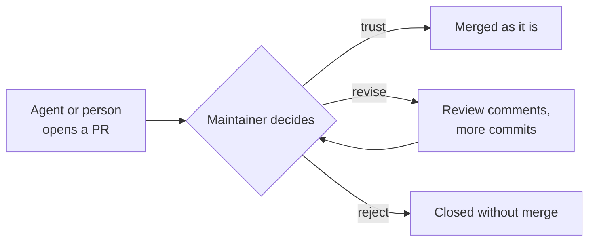
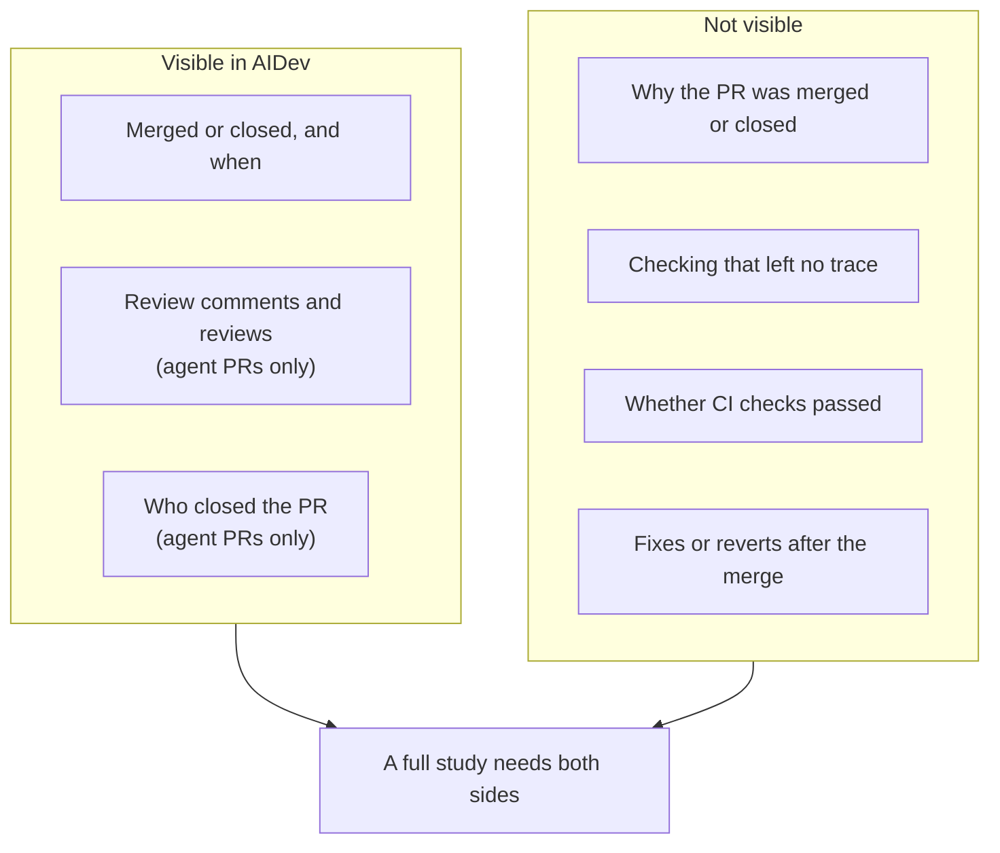
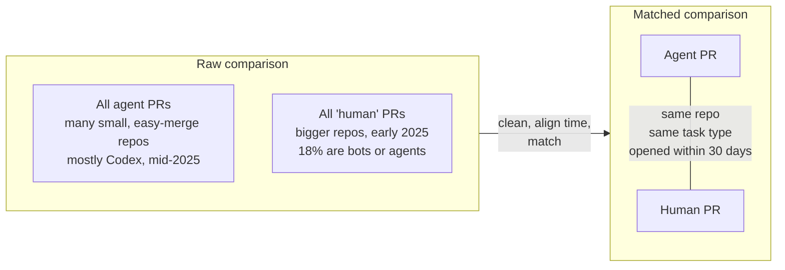
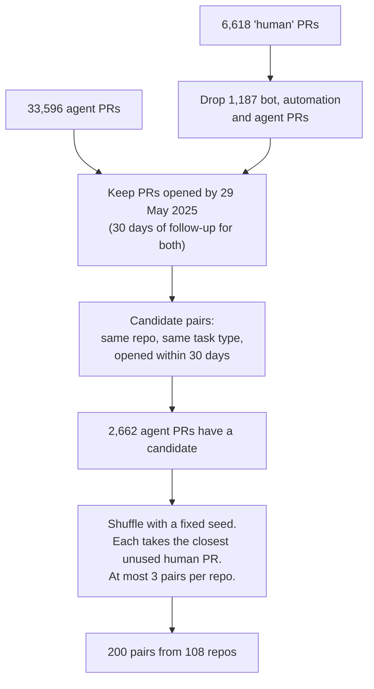
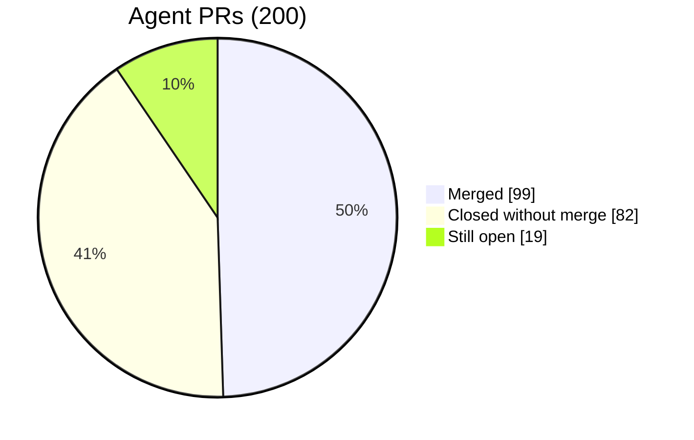
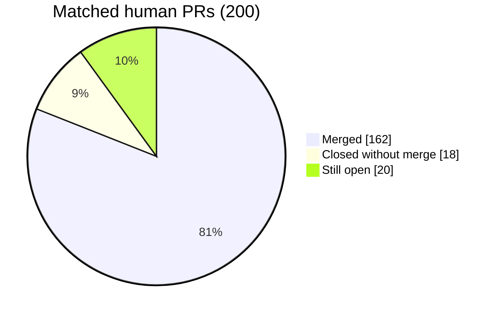
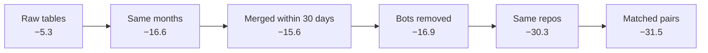
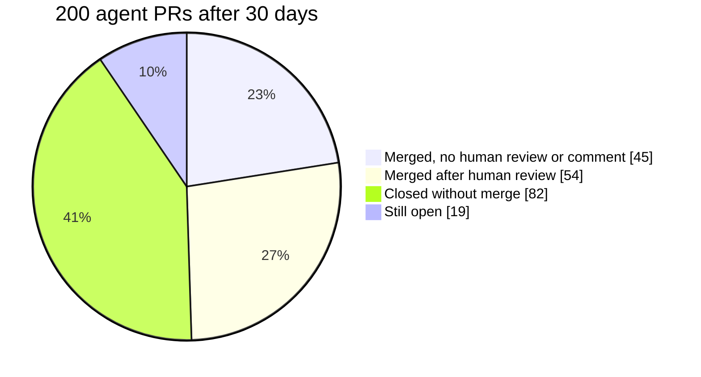
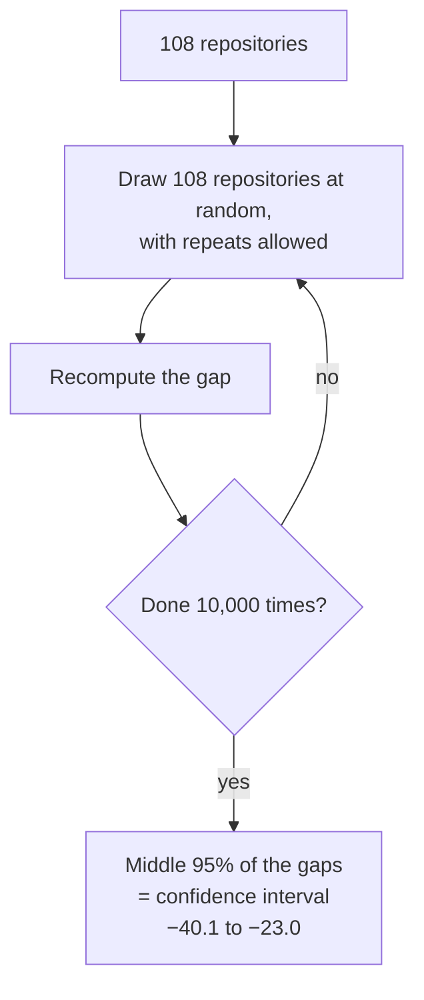
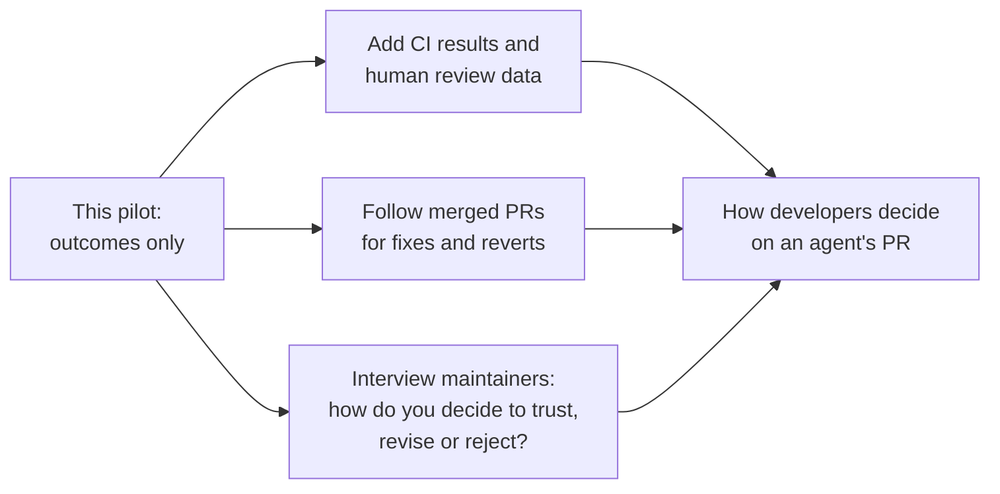

# The pilot in pictures

A visual walk through the ideas behind this pilot. Every number comes from [`results/results.md`](results/results.md). The diagrams render on GitHub.

## 1. What happens to a pull request

A coding agent (or a person) opens a pull request. Someone then decides what to do with it. This pilot is about that decision.

## 2. What public data can and can't see

The dataset records the outcome of the decision, not the thinking behind it.

## 3. Why a simple comparison isn't fair

Agent PRs and human PRs come from different projects, months and kinds of task. Comparing all of them mixes those differences into the result.

## 4. How the 200 pairs were built

## 5. What happened within 30 days

Merged: 49.5% of agent PRs against 81.0% of human PRs. The gap is −31.5 points (95% CI −40.1 to −23.0).

## 6. The gap depends on what you compare

Each step removes one unfair difference. Two steps move the gap: comparing the same months, and comparing the same repositories.

## 7. Inside the agent PRs: three decision paths

Only agent PRs have review data, so this view has no human comparison.

Two cautions:
- **"No human review" means no visible review.** A person may have read the change and left no trace.
- **"Closed" isn't always "rejected".** 30 of the 82 closed PRs were closed by the PR's own account: the Devin bot (18), the person who ran Codex (11) or the person who ran Claude Code (1).

## 8. Why the uncertainty is computed per repository

PRs in one repository are judged by the same people, so they aren't independent. The pilot therefore resamples whole repositories.

## 9. Where this leads

