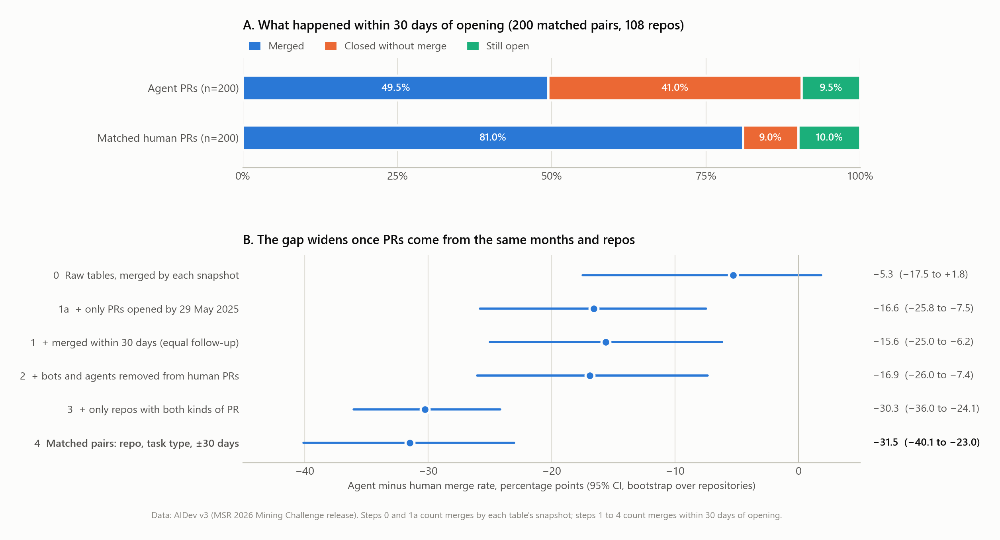

# Agent vs. human pull requests in AIDev: a small matched pilot

**What this is:** I compare pull requests (PRs) written by AI coding agents with matched human PRs from the same repositories, using the public AIDev dataset. Every result below is produced by the scripts in [`scripts/`](scripts/) and written to [`results/`](results/). Numbers quoted from other papers are cited.

**The short version.** I matched 200 agent PRs to human PRs from the same repo, with the same task type, opened within 30 days of each other. After 30 days, **49.5% of the agent PRs had been merged, against 81.0% of the human PRs**. That is a gap of −31.5 percentage points (95% CI −40.1 to −23.0). The agent PRs that did get merged went in about as fast as the human ones.

What the data can't show is _why_:

- who decided to merge or close a PR;
- what evidence they used;
- whether CI passed;
- what happened after the merge.

The dataset has no CI results and no review or commit history for the human PRs. That gap is the reason for the study I'd like to do next.



**New to the topic?** Two visual guides explain the background:
- [CONCEPTS.md](CONCEPTS.md): the research ideas in diagrams.
- [STATISTICS.md](STATISTICS.md): the methods (matching, confidence intervals, naive vs cluster bootstrap, effect sizes) with charts from this data.

## 1. Question

The question I want to study is **how developers decide when to trust, revise or reject a pull request written by a coding agent**. Wu, Li, Stolee and Xu (FSE 2026, [arXiv 2604.16393](https://arxiv.org/abs/2604.16393)) found that AI assistants make developers more focused on creating code and on evaluating and verifying the results the assistant generates. Autonomous agents push that verification into code review: a maintainer gets a finished PR and has to decide what to do with it.

Trace data shows only the outcome of that decision. So this pilot asks three narrower questions:

1. How often are agent PRs merged, closed or left open, compared with human PRs in the same repository, of the same kind, opened at about the same time?
2. How much visible review do the agent PRs get before the decision?
3. Which parts of the decision can AIDev observe at all: review, CI, and what happens after merge?

## 2. Data

**AIDev v3**: the [`hao-li/AIDev`](https://huggingface.co/datasets/hao-li/AIDev) release used by the MSR 2026 Mining Challenge, with data up to 1 August 2025 and a CC BY 4.0 licence. [`01_download_data.py`](scripts/01_download_data.py) pins Hugging Face commit `3ca0045773097b138b064550dfd6e72229f40bee` and checks each file's SHA-256.

I used v3 rather than the newer v5 (7.6M PRs, up to March 2026) because **v3 is the only release that includes human PRs** (`human_pull_request`). v4 and v5 dropped that table.

### Tables and fields

Full listing in [`results/schema.md`](results/schema.md).

| Table                                |             Rows | What it holds                                                                                                                     | Human PRs covered?   |
| ------------------------------------ | ---------------: | --------------------------------------------------------------------------------------------------------------------------------- | -------------------- |
| `pull_request`                       |           33,596 | AIDev-pop agent PRs from repos with more than 100 stars: state, `created_at`, `closed_at`, `merged_at`, author, repo, title, body | —                    |
| `human_pull_request`                 |            6,618 | Human PRs from the same repos, but only those with more than 500 stars. Same PR-level fields                                      | —                    |
| `pr_task_type`, `human_pr_task_type` |   33,596 / 6,618 | Task type assigned by an LLM (`feat`, `fix`, `docs`, …)                                                                           | yes                  |
| `pr_reviews`                         |           28,875 | Review submissions: reviewer, account type, state, time                                                                           | **no** (0 human PRs) |
| `pr_comments`                        |           39,122 | Conversation comments                                                                                                             | **no**               |
| `pr_review_comments_v2`              |           26,868 | Inline review comments; these join to a PR through `pr_reviews`                                                                   | **no**               |
| `pr_commits`, `pr_commit_details`    | 88,576 / 711,923 | Commits, plus per-file additions, deletions and patches                                                                           | **no**               |
| `pr_timeline`                        |          325,500 | Event history (`committed`, `reviewed`, `merged`, `closed`, `referenced`, …)                                                      | **no**               |
| `repository`                         |            2,807 | Stars, forks, language, licence                                                                                                   | —                    |

What the schema check found:

- **CI or check results: not included.** No column or timeline event records them. The only column whose name looks related, `pr_commit_details.status`, is a file's change status (added, modified and so on). The pilot doesn't call the GitHub API, so **it uses dataset fields only.**
- **After merge: not computable.**
  - `pr_timeline` has no `cross-referenced` events.
  - Its 2,010 `referenced` events carry a commit SHA but no message.
  - Human PRs have no timeline at all.

  So follow-up fix or revert commits within 30 days can't be identified from the dataset.

- **Truncation:** this release caps per-PR sub-resources at 30 rows. The v5 dataset card documents this bug. 2,603 agent PRs have exactly 30 timeline rows. In the sample, one agent PR hit the cap in `pr_reviews` and one in `pr_comments`.

### What prior work has already measured

AIDev underlies 62 accepted MSR 2026 Mining Challenge papers and others listed on the dataset card. The ones closest to this pilot:

- **Merge rate, agent vs. human:** the AIDev paper itself reports that agent PRs are accepted less often but processed faster ([2507.15003](https://arxiv.org/abs/2507.15003)). _Let's Make Every Pull Request Meaningful_ models merge outcomes for 40,214 human and agentic PRs ([2601.18749](https://arxiv.org/abs/2601.18749)). _Do AI-Generated Pull Requests Get Rejected More? (Yes but Why?)_ asks the same question (I've read only the title).
- **Why agent PRs aren't merged:** _Where Do AI Coding Agents Fail?_ looks at 33k agent PRs and relates non-merge to size, task type, CI build results and review dynamics ([2601.15195](https://arxiv.org/abs/2601.15195)). _Why Are Agentic Pull Requests Merged or Rejected?_ finds that only 35.7% of rejected agent PRs reflect clear agent failures ([2605.22534](https://arxiv.org/abs/2605.22534)).
- **Review:**
  - _On Autopilot?_ adds a human baseline. It reports that AI-co-authored PRs are merged faster with less feedback, and that about 80% of those from non-owners are merged without explicit review ([2601.13754](https://arxiv.org/abs/2601.13754)).
  - _When AI Teammates Meet Code Review_ links reviewer engagement to merging ([2602.19441](https://arxiv.org/abs/2602.19441)).
  - _Understanding Dominant Themes in Reviewing Agentic AI-authored Code_ builds a taxonomy of 19,450 inline review comments ([2601.19287](https://arxiv.org/abs/2601.19287)).
- **CI:** besides _Where Do AI Coding Agents Fail?_, at least three challenge papers study CI pipelines, CI/CD configuration changes and test failures in agent PRs (titles only).
- **After merge:**
  - _When AI Code Doesn't Stick_ studies reverted agent changes (title only).
  - _Beyond Bug Fixes_ runs SonarQube on 1,210 merged agent bug-fix PRs ([2601.20109](https://arxiv.org/abs/2601.20109)).
  - _Will It Survive?_ finds that agent-written code is modified _less_ often than human code ([2601.16809](https://arxiv.org/abs/2601.16809)).
  - _Code Change Characteristics and Description Alignment_ finds that functions and classes added by agent PRs are removed sooner (median 3 vs. 34 days; [2601.17627](https://arxiv.org/abs/2601.17627)).

**So this pilot claims no new result.** Merge gaps, review intensity, CI failures and reverts have all been measured before. It adds two things:

- an **audit of the human baseline** that several of these comparisons rely on;
- a **reproducible within-repository matched estimate** with repository-clustered confidence intervals, which shows how much the choice of comparison moves the merge gap.

## 3. Sampling and matching

I wrote the rules in [`ANALYSIS_PLAN.md`](ANALYSIS_PLAN.md) before computing any outcome. Three changes made afterwards are listed at the end of that file; none of them alters a planned number. Matching uses no outcome fields.

1. **Clean the human baseline.** [`results/human_baseline_audit.md`](results/human_baseline_audit.md) lists 1,187 human PRs (17.9%) that the rules drop:

   | Reason                             |   PRs |
   | ---------------------------------- | ----: |
   | Bot or automation account          | 1,078 |
   | Agent signature in the body        |   125 |
   | Also in the agent table (same URL) |    56 |

   A PR can match more than one rule, so these rows add up to more than 1,187.
   - The bot accounts are mostly `dependabot[bot]` (421 PRs), `renovate[bot]` (168), `github-actions[bot]` (143) and `airbyteio` (136).
   - Agent accounts are among them too: `devin-ai-integration[bot]` (21) and `gru-agent[bot]` (21).
   - Agent signatures are things like a "Generated with Claude Code" footer or a Codex or Devin task link.

2. **Give both groups equal follow-up time.** The human table's latest timestamp is 2025-06-28 23:07:52 UTC, 32.0 days before the agent table's. I therefore count "merged within 30 days of opening" and keep only PRs opened by 2025-05-29 23:07:52 UTC.
3. **Match 1:1.**
   - A candidate pair is an agent PR and a cleaned human PR in the same repository, with the same task type, opened at most 30 days apart.
   - Agent PRs are shuffled with a fixed seed (2026), then each is paired greedily with the closest-in-time human PR not already used.
   - No repository contributes more than 3 pairs.
   - **Size can't be matched**, because human PRs have no commit or diff data.

**Sample** ([`results/sample.md`](results/sample.md)):

- 2,662 agent PRs had at least one candidate. The 200 pairs come from 108 repositories.
- The two PRs in a pair were opened a median 5.1 days apart (maximum 29.8).
- **By agent:** Devin 102, Codex 63, Copilot 29, Claude Code 4, Cursor 2.
- **By task type:** feat 86, fix 63, docs 22, refactor 17, chore 6, test 4, build 2.
- **Size (agent PRs only):** median 102 lines changed (IQR 30 to 367) across 3 files (IQR 2 to 7).

## 4. Results

All results are in [`results/results.md`](results/results.md). Intervals are 95%. Group rates use Wilson intervals. Gaps and effect sizes use a bootstrap that resamples whole repositories (10,000 resamples).

### Matched sample: 200 pairs, 108 repositories

| Within 30 days of opening                | Agent PRs                     | Human PRs                      | Agent minus human         | Effect size                      |
| ---------------------------------------- | ----------------------------- | ------------------------------ | ------------------------- | -------------------------------- |
| **Merged** (primary)                     | 99/200 = 49.5% (42.6 to 56.4) | 162/200 = 81.0% (75.0 to 85.8) | −31.5 pp (−40.1 to −23.0) | Cohen's h −0.68 (−0.87 to −0.49) |
| Closed without merge                     | 82/200 = 41.0% (34.4 to 47.9) | 18/200 = 9.0% (5.8 to 13.8)    | +32.0 pp (+23.6 to +40.5) | h 0.78 (0.58 to 0.99)            |
| Still open at day 30                     | 19/200 = 9.5% (6.2 to 14.4)   | 20/200 = 10.0% (6.6 to 14.9)   | −0.5 pp (−6.8 to +5.8)    | h −0.02 (−0.23 to 0.20)          |
| Hours to merge, median (merged PRs only) | 1.8 (0.8 to 6.2), n = 99      | 2.5 (1.1 to 5.6), n = 162      | —                         | Cliff's δ −0.04 (−0.19 to 0.12)  |

Agent PRs were far more often closed without merge. Among PRs that were merged, there was no detectable difference in speed: a negative δ would mean agent PRs merge faster, and the interval rules out anything beyond a small effect either way.

### How the comparison changes the gap (Figure 1, panel B)

| Step | What changes                                  | Agent / human PRs | Agent merged | Human merged | Gap (95% CI)              |
| ---- | --------------------------------------------- | ----------------- | -----------: | -----------: | ------------------------- |
| 0    | Raw tables, merged at each table's snapshot   | 33,596 / 6,618    |        71.5% |        76.8% | −5.3 pp (−17.5 to +1.8)   |
| 1a   | Only PRs opened by 29 May 2025                | 7,755 / 5,287     |        62.3% |        78.9% | −16.6 pp (−25.8 to −7.5)  |
| 1    | Outcome becomes merged within 30 days         | 7,755 / 5,287     |        61.7% |        77.3% | −15.6 pp (−25.0 to −6.2)  |
| 2    | Bots and agents removed from the human table  | 7,755 / 4,404     |        61.7% |        78.5% | −16.9 pp (−26.0 to −7.4)  |
| 3    | Only the 357 repos that have both kinds of PR | 3,787 / 3,505     |        48.7% |        79.0% | −30.3 pp (−36.0 to −24.1) |
| 4    | Matched pairs: repo, task type, ±30 days      | 200 / 200         |        49.5% |        81.0% | −31.5 pp (−40.1 to −23.0) |

Two steps move the gap.

- **Step 1a, restricting to the same months**, changes which agents are compared. Codex falls from 65% of the agent PRs to 44%, and Devin rises from 14% to 44%.
- **Step 3, restricting to repositories that also have human PRs**, nearly doubles the gap. In those repos, all with more than 500 stars, only 48.7% of agent PRs were merged within 30 days, against 61.7% across all repos in step 2.

Matching on task type and creation time (step 4) changes the gap very little beyond step 3. Equalising follow-up time (step 1) and cleaning the human baseline (step 2) each move it by about one point. **The audit's problems matter little for merge rate, but where you compare matters a lot.**

### Agent PRs only: review activity and decision paths

There is no human comparator here, because the dataset has no review data for human PRs. "Human" means a non-bot account other than the PR's author. Only activity before the merge or close counts, or up to day 30 if the PR is still open.

| Measure                                 | Result                                                 |
| --------------------------------------- | ------------------------------------------------------ |
| Review comments (inline + conversation) | median 0 (IQR 0 to 1), mean 1.57; none on 58.5% of PRs |
| Review rounds (submitted reviews)       | median 0 (IQR 0 to 1), mean 0.95; none on 65.5% of PRs |
| Merged with no human review or comment  | 45 (22.5%)                                             |
| Merged after human review or comment    | 54 (27.0%)                                             |
| Closed without merge                    | 82 (41.0%)                                             |
| Still open at day 30                    | 19 (9.5%)                                              |

Of the 99 agent PRs merged within 30 days, **45 (45.5%, 95% CI 36.0 to 55.2) carry no review or comment from anyone but the author**.

This is partly a matter of who the author is:

- For **Codex**, the author is the person who ran the agent; 25 of its 35 merged PRs had no other reviewer.
- For **Devin**, the author is the bot; 18 of its 51 merged PRs had no human comment at all.
- **Copilot** PRs were never merged without one.

**"Closed without merge" isn't the same as "rejected by a reviewer"** (a check added after the first run). Of the 82 closed agent PRs:

| Closed by                         | PRs |
| --------------------------------- | --: |
| Another human                     |  43 |
| The PR's own author account       |  30 |
| No `closed` event in the timeline |   9 |

The 30 closed by the author account break down as the Devin bot itself (18), the person who ran Codex (11) and the person who ran Claude Code (1). Human PRs have no timeline, so this can't be compared.

## 5. Limitations

- **The human baseline is thin.** Human PRs have PR-level fields only. That rules out:
  - matching on size;
  - comparing review effort;
  - comparing CI results;
  - looking at what happened after merge.

  Human PRs also come only from repositories with more than 500 stars, sampled by the dataset authors.

- **The sample is mostly Devin and early Codex.** It covers PRs opened from late December 2024 to May 2025 and is 51% Devin and 32% Codex, while AIDev-pop as a whole is 65% Codex. Claude Code (4 pairs) and Cursor (2) are barely represented. These results say little about today's agents.
- **The matching is coarse.** It uses repository, task type and creation time only. Not controlled:
  - **Author role and experience.** Human PRs here may come largely from core maintainers; I didn't check. Devin and Copilot PRs show only the bot as author, so the person who started them is unknown.
  - **Size.**
  - **Task difficulty.** The task types are LLM labels shipped with the dataset, which I didn't validate.
- **Some outcome definitions are rough.**
  - "Closed without merge" mixes rejection, abandonment and self-closing.
  - Time to merge is measured only on merged PRs, so it is subject to selection: the agent PRs that got merged may be the easy ones.
  - "No human review" means no _visible_ review. A maintainer may have read the diff and left no trace.
- **The cleaning rules are heuristics.** They use the login suffix, two named accounts and agent signatures, so they may miss some automation or drop a person whose login ends in "bot".
- **The snapshot dates are inferred** from the latest timestamp in each table. If the human table was captured later than that, the 30-day window is still fully observed.
- **The statistics are kept simple.** There are 108 repository clusters and three secondary outcomes, with no multiplicity correction and no p-values. The analysis plan fixes the primary outcome in advance. The three changes made after the first run are listed in [`ANALYSIS_PLAN.md`](ANALYSIS_PLAN.md).

## 6. What a full study would do next

1. **Close the data gaps for both groups.** With an authenticated GitHub API (for example, `gh`) and within rate limits, fetch reviews, comments, commits, timelines and check-runs for the matched human _and_ agent PRs. That enables matching on size, comparing review effort, and asking whether a PR passed CI before the decision.
2. **Move to recent agents.** Use AIDev v5 (to March 2026, with the 30-row cap fixed) and sample human PRs from the same repositories and months. v5 has no human table.
3. **Follow PRs past the merge.** Use treeless clones of the repositories plus SZZ (PyDriller) to link later fix and revert commits to merged agent and human PRs within 30 and 90 days.
4. **Model the decision.** Fit mixed-effects logistic models (repository as a random effect) of merge, close and revert on size, CI status, author role and agent.
5. **Ask the people who decide.** Code a sample of closed agent PRs for who closed them and why, then interview maintainers about **how they decide to trust, revise or reject an agent's PR**: what evidence they look at (CI, tests, diff size, the agent's track record) and what verification they do that leaves no trace in the PR. In this sample, 45% of merged agent PRs carry no visible review, so this is exactly where trace data runs out.

## 7. Reproduce

Requires Python 3.8 and about 600 MB of disk for the data. Once the data is downloaded, a full run takes about a minute. A re-run reproduces every file in `results/` and `figures/` byte for byte.

```bash
python -m venv .venv
.venv/Scripts/python -m pip install -r requirements.txt   # on macOS/Linux: .venv/bin/python
.venv/Scripts/python scripts/run_all.py
```

`run_all.py` runs these six scripts in order:

| Script                                                 | What it does                                               | Output                                                                                                                                           |
| ------------------------------------------------------ | ---------------------------------------------------------- | ------------------------------------------------------------------------------------------------------------------------------------------------ |
| [`01_download_data.py`](scripts/01_download_data.py)   | Downloads the pinned AIDev tables and checks their SHA-256 | `data/aidev_v3/`                                                                                                                                 |
| [`02_inspect_schema.py`](scripts/02_inspect_schema.py) | Lists tables, fields, coverage and CI fields               | [`results/schema.md`](results/schema.md)                                                                                                         |
| [`03_build_sample.py`](scripts/03_build_sample.py)     | Audits the human baseline and builds the matched pairs     | [`human_baseline_audit.md`](results/human_baseline_audit.md), [`matched_pairs.csv`](results/matched_pairs.csv), [`sample.md`](results/sample.md) |
| [`04_analyze.py`](scripts/04_analyze.py)               | Computes outcomes, bootstrap CIs and review activity       | [`results.md`](results/results.md), [`metrics.json`](results/metrics.json), [`pair_outcomes.csv`](results/pair_outcomes.csv)                     |
| [`05_make_figure.py`](scripts/05_make_figure.py)       | Draws Figure 1                                             | [`figures/figure1.png`](figures/figure1.png)                                                                                                     |
| [`06_concept_figures.py`](scripts/06_concept_figures.py) | Draws the teaching charts in STATISTICS.md               | `figures/concepts/`, [`results/concepts.md`](results/concepts.md)                                                                                |

Shared rules and statistics live in [`scripts/aidev.py`](scripts/aidev.py). Outputs are deterministic: seed 2026, pinned data.

**Data citation:** Hao Li, Haoxiang Zhang and Ahmed E. Hassan. _The Rise of AI Teammates in Software Engineering (SE) 3.0_, arXiv 2507.15003, and _AIDev: Studying AI Coding Agents on GitHub_, arXiv 2602.09185. The dataset is CC BY 4.0; each source repository keeps its own licence.
