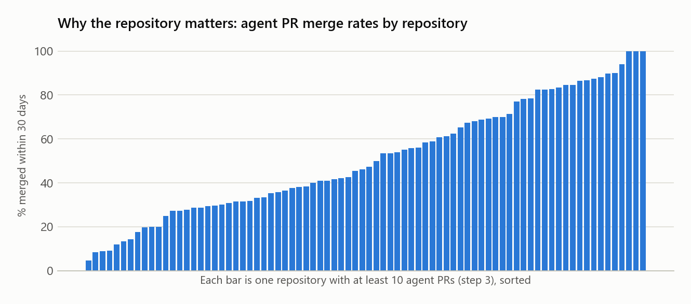
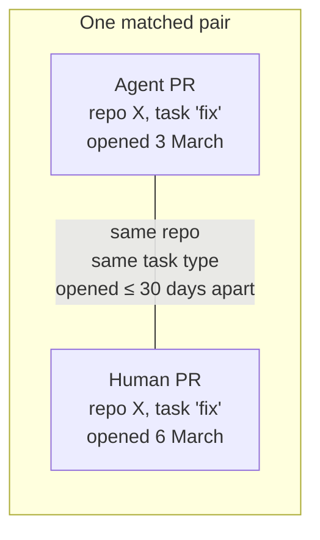
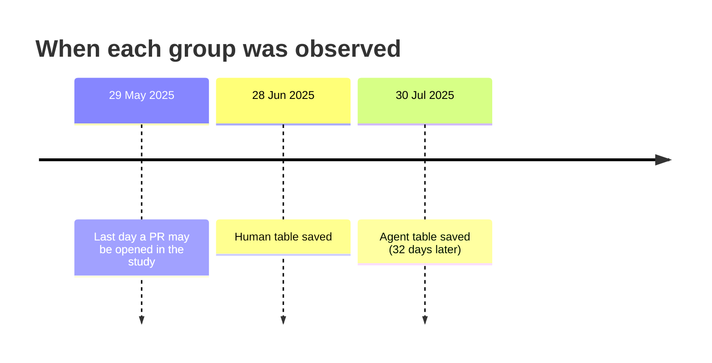
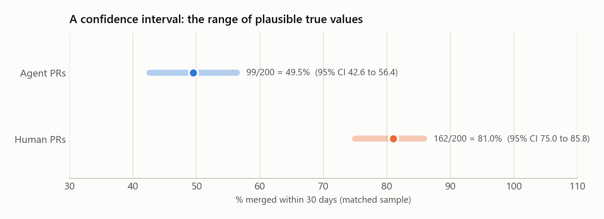
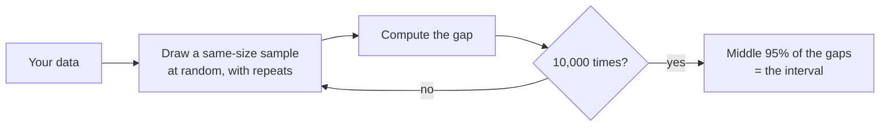
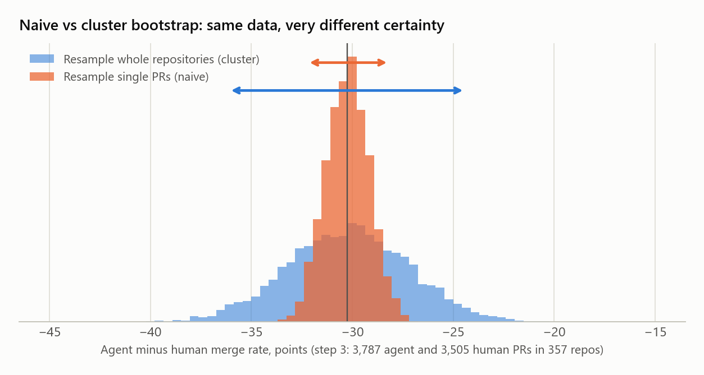
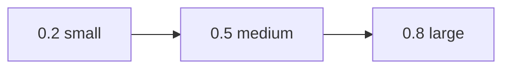
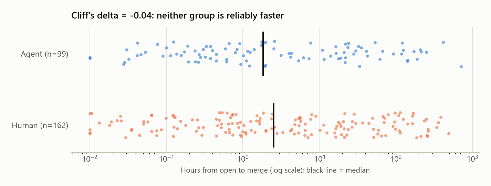
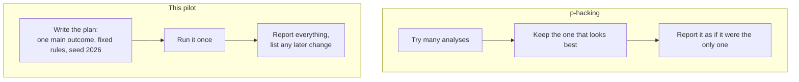
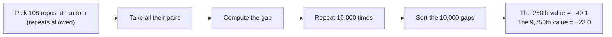

# The statistics in pictures

Plain-language explanations of every method in this pilot, with charts drawn from the pilot's own data by [`scripts/06_concept_figures.py`](scripts/06_concept_figures.py). The numbers behind the charts are in [`results/concepts.md`](results/concepts.md). For the research ideas themselves, see [CONCEPTS.md](CONCEPTS.md).

## 1. Confounding: why a raw comparison misleads

Two groups can differ in more than the thing you're studying. Here, the repository a PR lands in matters a lot. Among repositories with at least 10 agent PRs, the share merged within 30 days ranges from 5% to 100% (median 47%).

If agent PRs mostly sit in easy-merge repositories and human PRs in strict ones, a raw comparison measures the repositories, not the authors. That is why the gap is −5.3 points on the raw tables but −30.3 within the same repositories.

## 2. Matching: compare like with like

Instead of comparing everything, give each agent PR a human "twin" that is similar on what affects the outcome.

Whatever differs within a pair can no longer be the repository, the kind of task or the month. It can still be things we couldn't match on, such as PR size or the author's experience.

## 3. Equal follow-up time (the snapshot problem)

Each table was saved at a different moment, so PRs had different amounts of time to get merged.

The fix is to ask the same question of every PR: **was it merged within 30 days of opening?** A PR opened by 29 May has its full 30 days visible in both tables.

## 4. Confidence interval: a range, not a single number

99 of 200 agent PRs were merged (49.5%). Another random 200 would give a slightly different number. A **95% confidence interval** is the range of true values that fit the data. The **Wilson** formula computes it well for small samples.

The two ranges don't come near each other, so the difference isn't luck.

## 5. Bootstrap: let the computer measure the uncertainty

When there's no simple formula, simulate one:

## 6. Naive vs cluster: what do you resample?

This is the most important statistical choice in the pilot.

- **Naive:** treat every PR as independent and resample single PRs.
- **Cluster:** treat each repository as one unit, and resample whole repositories.

PRs in the same repository are judged by the same maintainers under the same rules, so they move together. Resampling single PRs pretends we have thousands of independent observations, when really we have a few hundred repositories.

On the same data (step 3: 3,787 agent and 3,505 human PRs in 357 repos):

| Method | 95% interval | Width |
| --- | --- | ---: |
| Naive (single PRs) | −32.2 to −28.2 | 4.1 points |
| Cluster (repositories) | −36.1 to −24.4 | 11.7 points |

The naive interval is almost three times too narrow: it would claim far more certainty than the data supports. Every interval in this pilot uses the cluster version.

(In the 200-pair sample the two methods give almost the same interval, because no repository has more than 3 pairs.)

## 7. Effect size: how big, not just how sure

An interval says how certain we are. An **effect size** says how big the difference is, on a scale that doesn't depend on sample size.

**Cohen's h** compares two percentages:

The merge gap is h = −0.68: between medium and large.

**Cliff's delta** compares skewed numbers such as hours. Take every agent PR and every human PR, and count how often the agent one was slower minus how often it was faster, divided by all comparisons. It runs from −1 (agent always faster) to +1 (agent always slower), and anything within ±0.15 is negligible.

The dots overlap almost completely, which is what δ = −0.04 means: no detectable difference in speed. Note this only covers PRs that were merged, and the agent PRs that got merged may be the easy ones.

## 8. Why the plan was written first (no p-hacking)

Fixing the random seed in advance means it can't be picked to make the result look better. Rerunning the matching with 10 other seeds gives gaps between −27.0 and −40.5 points, so the reported −31.5 isn't an unusual draw.

## 9. Worked examples: how each number was calculated

All numbers here are printed by `06_concept_figures.py` into [`results/concepts.md`](results/concepts.md), so you can check every step.

### The gap, in "points"

A **percentage point** is the plain difference between two percentages.

| | Merged within 30 days |
| --- | --- |
| Agent PRs | 99 of 200 = 0.495 = 49.5% |
| Human PRs | 162 of 200 = 0.810 = 81.0% |
| Gap | 49.5 − 81.0 = **−31.5 points** |

Say "31.5 points lower", not "31.5% lower". (31.5% lower would mean 81.0 × 0.685 = 55.5%, a different claim.)

### The gap's interval: −40.1 to −23.0

There's no simple formula that respects repositories, so the bootstrap does it:

The 250th and 9,750th values cut off 2.5% at each end, leaving the middle 95%. This is called a **percentile interval**.

### The Wilson interval for 99/200

Plain idea: a percentage from 200 cases is a little uncertain. Wilson gives the range, and it never goes below 0% or above 100%.

With p = 0.495, n = 200 and z = 1.96 (the number for 95%):

1. **Centre:** (p + z²/2n) / (1 + z²/n) = **0.4951**. Wilson nudges the centre slightly towards 50%.
2. **Half-width:** z × √(p(1−p)/n + z²/4n²) / (1 + z²/n) = **0.0686**.
3. **Interval:** 0.4951 ± 0.0686 = **0.426 to 0.564**, i.e. 42.6% to 56.4%.

You don't need to memorise the formula. Know that it's the recommended interval for a percentage, and why (next box).

**Why Wilson and not the textbook (Wald) formula?** Wald is p ± 1.96 × √(p(1−p)/n). For 99/200 both give 42.6 to 56.4, so here it makes no difference. With small samples or rates near 0% or 100%, Wald breaks. For example, with 2 out of 20:

| Method | 95% interval for 2/20 |
| --- | --- |
| Wald | −3.1% to 23.1%: impossible, a rate can't be negative |
| Wilson | 2.8% to 30.1% |

The per-agent groups in this pilot are that small (Cursor has 2 pairs), so a safe method is the right default.

### Cohen's h = −0.68

Plain idea: a 10-point gap means more near 0% or 100% than near 50%. h stretches the scale to correct for that, so effects can be compared across studies.

1. Transform each rate: 2 × arcsin(√p).
   - Agent: 2 × arcsin(√0.495) = **1.5608**
   - Human: 2 × arcsin(√0.810) = **2.2395**
2. **h = 1.5608 − 2.2395 = −0.68**, between "medium" (0.5) and "large" (0.8).

### Median hours: why not the average?

| | Median | Mean (average) | Longest |
| --- | ---: | ---: | ---: |
| Agent PRs (99 merged) | 1.8 h | 36.8 h | 709.3 h |
| Human PRs (162 merged) | 2.5 h | 39.9 h | 491.5 h |

Most PRs merge within hours, but a few take weeks. Those few pull the mean up to about 37–40 hours, which describes almost no real PR. The **median** is the middle PR: half merged faster, half slower. It isn't moved by a few extreme cases.

### Cliff's delta = −0.04

Compare **every** merged agent PR with **every** merged human PR:

| Step | Count |
| --- | ---: |
| Comparisons: 99 × 162 | 16,038 |
| Agent PR was slower | 7,726 |
| Agent PR was faster | 8,311 |
| Exactly equal | 1 |
| δ = (7,726 − 8,311) / 16,038 | **−0.036 ≈ −0.04** |

Almost an even split, so neither group is reliably faster. Its interval (−0.19 to 0.12) comes from the same repository bootstrap.

## 10. Why these methods, and not others?

Each choice below was made because of a specific property of this data. A reviewer may ask about any of them.

| We used | Instead of | Why |
| --- | --- | --- |
| **Confidence intervals** | p-values and significance tests | An interval shows both how big the gap is and how sure we are. A p-value only says "unlikely to be zero", and invites yes/no thinking. |
| **Repository bootstrap** | Chi-square test or textbook formulas | Those assume every PR is independent. PRs in one repo aren't, so they would give intervals about 3 times too narrow (section 6). |
| **Wilson interval** | Wald interval | Wald can give impossible ranges with small groups (the 2/20 example). |
| **Difference in points** | Odds ratio | An odds ratio is valid but hard to picture ("odds 0.23 times as high"). "49.5% vs 81.0%" is clear to anyone. Cohen's h adds a standard scale. |
| **Median and Cliff's delta** | Mean and t-test | Hours are very skewed (a few PRs take weeks). The mean and t-test are pulled by those few; medians and Cliff's delta aren't. |
| **Cliff's delta** | Mann–Whitney U test | They're the same idea: δ = 2U / (n₁n₂) − 1. Mann–Whitney gives a p-value; δ gives the size of the effect, which is what we report. |
| **Exact matching** (repo, task type, time) | Propensity-score matching | Propensity scores combine many traits into one score. We only had three traits for human PRs, so exact matching is simpler and fully transparent. |
| **Matching** | Regression with controls | With 200 pairs and few traits, matching is easy to check by eye: open any pair on GitHub. The full study would add mixed-effects regression once size, author and CI data exist. |
| **Merged within 30 days** | Survival analysis (time-to-event) | Survival analysis would use every PR's time, including unmerged ones, and is better for speed questions. It's a sensible next step; for a pilot, a fixed 30-day window is easier to explain. |
| **One primary outcome** | Testing many outcomes, then correcting (e.g. Bonferroni) | Fixing one main outcome in advance avoids the multiple-testing problem. The other outcomes are reported as description, not tests. |

**An honest weak spot:** the time-to-merge comparison uses only merged PRs. If the easy agent PRs are the ones that get merged, the agent group looks faster than it really is. Survival analysis or a model of the full process would fix that in the full study.

## Quick reference

| Term | One-line meaning |
| --- | --- |
| Confounding | A hidden difference between groups that distorts the comparison |
| Matching | Pairing each case with a similar comparison case |
| Horizon | A fixed follow-up window, here 30 days |
| Percentage point | The plain difference between two percentages (49.5 − 81.0 = −31.5 points) |
| Median | The middle value; not pulled by a few extreme cases |
| Confidence interval | The range of plausible true values |
| Percentile interval | The middle 95% of the bootstrap results |
| Wald interval | The textbook interval for a percentage; breaks with small groups |
| Wilson interval | A good confidence-interval formula for percentages |
| Bootstrap | Measuring uncertainty by resampling the data many times |
| Naive bootstrap | Resampling single observations as if independent |
| Cluster bootstrap | Resampling whole groups (here, repositories) |
| Cohen's h | Effect size for two percentages |
| Cliff's delta | Effect size for skewed numbers: P(slower) − P(faster) |
| p-hacking | Trying many analyses and reporting the one that "works" |
